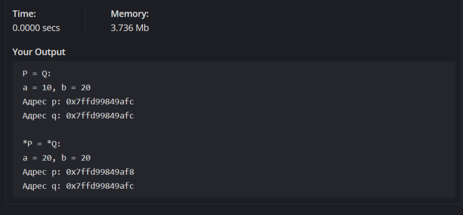
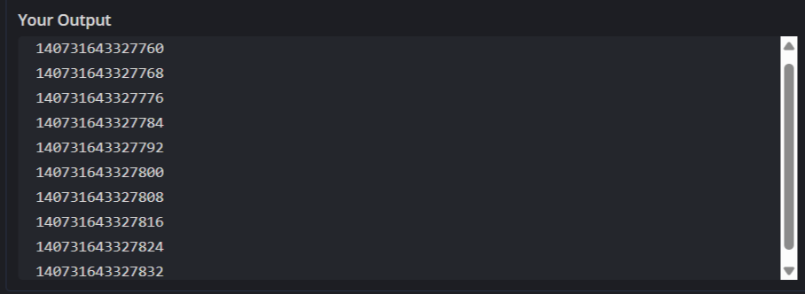
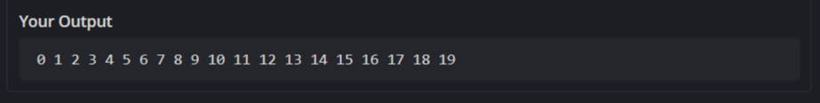

# Языки программирования
## Лабораторная работа 10

### Задание 1 **(2)** - СДЕЛАЛ

*Рассмотрите следующие фрагменты программ. Запишите, что означают символы* **&** и  * *в каждом случае применения.*
```
int a = 10, b = 20;
int *p = &a , *q = &b;
p = q;
std::cout << *p <<' '<< *q << std::endl;
```
- "int *p": "*" в объявлении означает, что p - это указатель на int.
- "&a, &b": "&" - это взятие адреса: p получает адрес a, q - адрес b.
- "p = q" - присваивается адрес: теперь p указывает туда же, куда q, то есть на b. Переменная a не меняется.
- "*p, *q": "*" - разыменование: берётся значение по адресу. Оба указывают на b, поэтому вывод: 20 20.
```
int a = 10, b = 20;
int *p = &a , *q = &b;
*p = *q;
std::cout << *p <<' '<< *q << std::endl;
```
- "int *p: "*" в объявлении означает что p это указатель.
- "p = *q: здесь "*" с обеих сторон - это разыменование: значение по адресу q (то есть b = 20) копируется по адресу p (то есть в a). Указатели не меняются, меняется значение a.
- "*p, *q": это разыменование.

*Чем различаются присваивания в третьей строке? Что можно вывести,
чтобы показать различия?*
- В первом случае p = q происходит копирование адреса. Указателю p присваивается адрес, который хранится в q. В результате оба указателя начинают указывать на одну переменную b, а значение a не изменяется.
- Во втором случае *p = *q происходит копирование значения. Значение переменной b записывается в переменную a. При этом указатели остаются на своих прежних местах.

*Примеры программ сохраните в папке с номером задания. Скриншоты работы прикрепите к отчету.*



### Задание 2 **(1)** - СДЕЛАЛ

*Рассмотрим следующую программу.* 
```
double x[10];
for (int i = 0; i <10; i++)
    std::cout << &x[i] << std::endl;
```
*Что она выводит? Измените
вывод так, чтобы адреса выводились в десятичной системе счисления.
Объясните почему числа составляют арифметическую прогрессию с
определенным шагом.*
- Она выводит адреса всех 10 элементов массива x.
- В арифметической прогрессии числа располагаются с одинаковым шагом, потому что элементы массива хранятся в памяти последовательно, друг за другом.
- Размер одного элемента типа double обычно составляет 8 байт, поэтому адрес каждого следующего элемента увеличивается на 8.
- Чтобы адреса выводились в десятичной системе счисления, нужно использовать reinterpret_cast<uintptr_t>.

*Записанную программу сохраните в папке с номером задания.*
*Скриншоты работы прикрепите к отчету.*


### Задание 3 **(2)**

*Токен* **«*»** *в языке C++ может использоваться в трех различных
случаях. Аналогично токен* **«&»** *также может использоваться в трех
случаях. Приведите пример одной программы в которой они были бы
использованы во всех случаях.*

*Записанную программу сохраните в папке с номером задания.*

### Задание 4 **(2)**

*Выпишите значения всех переменных, в том числе указателей,
после выполнения каждой инструкции программы. Объясните, что
происходит в результате выполнения каждой инструкции.*
```
unsigned a = 8, b = 3 ,c = 17;
unsigned *p = &a;
unsigned *q = &b;
*p += *q + c;
c = *q;
p = &c;
c += a;
*p += 10;
*q = *p;
q = p ;
*q += 10;
```

### Задание 5 **(1)**

*Что сравнивается в приведенной ниже программе? Как можно
изменить первую строчку программы, чтобы результат тоже
изменился?*
```
int x = 1, y = 2;
int *p = &y, *q = &x;
if (p < q)
    std::cout << "Yes";
else
    std::cout << "No";
```


### Задание 6 **(2)**

*Объясните работу следующей программы. Как изменится
результат, если тип* **double** *изменить на некоторый другой, например*
**int** *или* **char**?
```
double x = 0;
double *d = &x;
std::cout << reinterpret_cast<size_t>(d + 4) - reinterpret_cast<size_t>(d - 4) << std::endl;
```

### Задание 7 **(2)**

*Объясните работу следующей программы. Как изменится
результат, если тип* **double** *изменить на некоторый другой, например*
**int** *или* **char**?
```
std::cout << reinterpret_cast <double*>(3000) - reinterpret_cast <double*>(2000) << std::endl;
```

### Задание 8 **(2)** - СДЕЛАЛ

*Что надо дописать в записанной ниже программе вместо многоточий, чтобы
она выводила все числа из массива* **a**? *Почему?*
```
int a[20];
for ( int i = 0; i < 20; i++)
    a[i] = i;
int *b=a + 8;
for (int i =...; i <...; i++)
    std::cout << b[i] <<' ';
```
- Вместо многоточий нужно написать сначала "-8", а потом "12"
- Указатель b указывает на элемент a[8].
- Чтобы вывести все элементы массива, нужно начать с b[-8], потому что он соответствует a[0].
- Цикл заканчивается при i = 12, так как b[11] соответствует последнему элементу a[19].
- Поэтому программа выводит числа от 0 до 19.



### Задание 9 **(2)** - СДЕЛАЛ

*Что выводит следующая программа? Изменится ли результат если
изменить тип элементов массива?*

```
int a[10];
std::cout << &a[8] - &a[3] << std::endl;
```
- Программа выводит 5.
- Выражение &a[8] получает адрес восьмого элемента массива, а &a[3] - адрес третьего элемента.
- При вычитании указателей получается количество элементов между ними, а не разница в байтах.
- Если изменить тип элементов массива, то результат не изменится. Он всё равно будет равен 5, потому что считается количество элементов.

### Задание 10 **(1)**

*Есть ли разница между инициализацией* **p** и **q** *в следующей программе? Обоснуйте ответ.*
```
int x [10]={1, 2, 3, 4, 5, 6, 7, 8, 9, 10};
int *p = x + 5;
int *q = &x[5];
```

### Задание 11 **(3)**

*Указатели можно использовать для итерации по массивам.
Напишите программу, которая найдет сумму элементов массива,
используя указатели. В начале цикла указатель требуется установить
на начало массива, в конце каждой итерации смещать его к
следующему элементу массива через инкремент. Для выхода из цикла
надо проверять, что указатель дошел до конца массива.*
```
int x [10]={1, 2, 3, 4, 5, 6, 7, 8, 9, 10};
int s = 0;
for (int *p = ...; ...; ...)
    s += ...
std::cout << s;
```

*Записанную программу сохраните в папке с номером задания.*


## Дополнительные задания

### Задание 1 **(3)**

*Запишите программу на С++, в которой будет создаваться двумерный массив* **x[10][10]**. *Выведите адреса элементов массива и нарисуйте, как элементы расположены в памяти.*

### Задание 2 **(3)**

*Запишите программу на С++, в которой будет создаваться двумерный массив* **x[10][10]**. *Проверьте, что произойдет при различных выходах за границы массива. Напишите программы для демонстрации и поясните
их работу.* 

### Задание 3 **(6)**
*Напишите пример программы, которая продемонстрирует неопределенное поведение при выходе за границу одномерного массива. Например, чтобы программа зависла, хотя по алгоритму такого не должно произойти

### Задание 4 **(8)**
*Изучите самостоятельно работу с динамической памятью. Напишите примеры программ, демонстрирующие особенности работы (например, перемещение при расширении) и возможные ошибки при работе с памятью.* 
